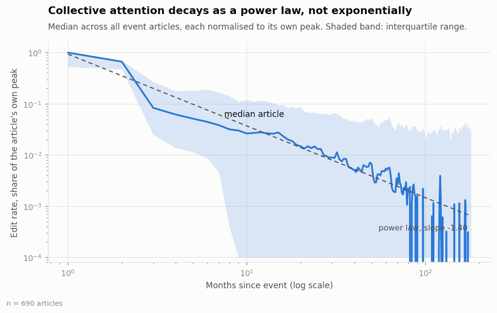
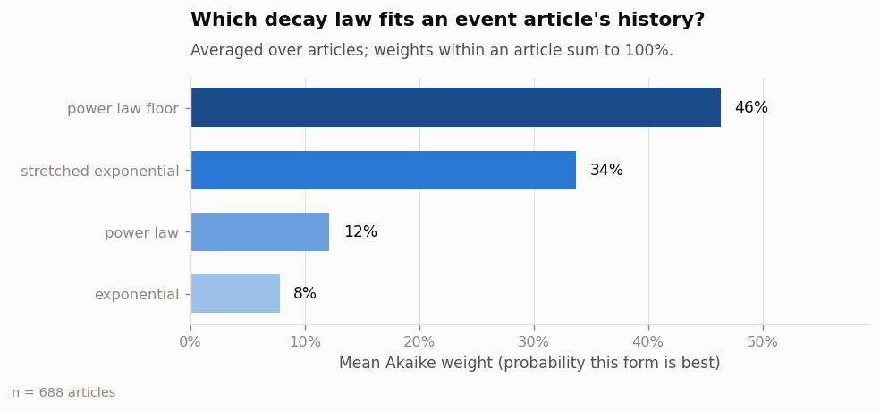
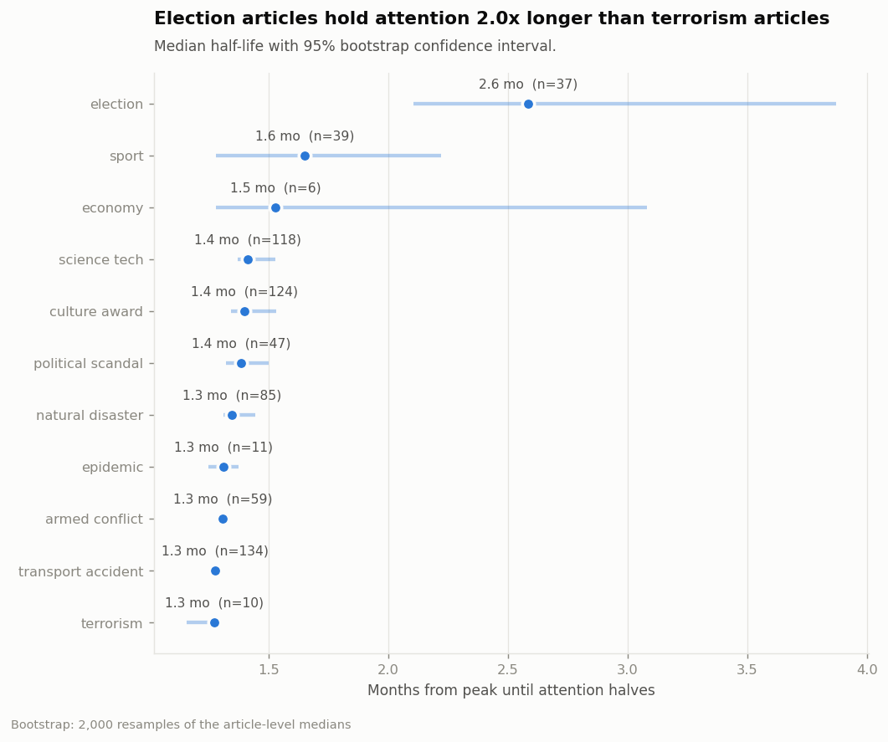
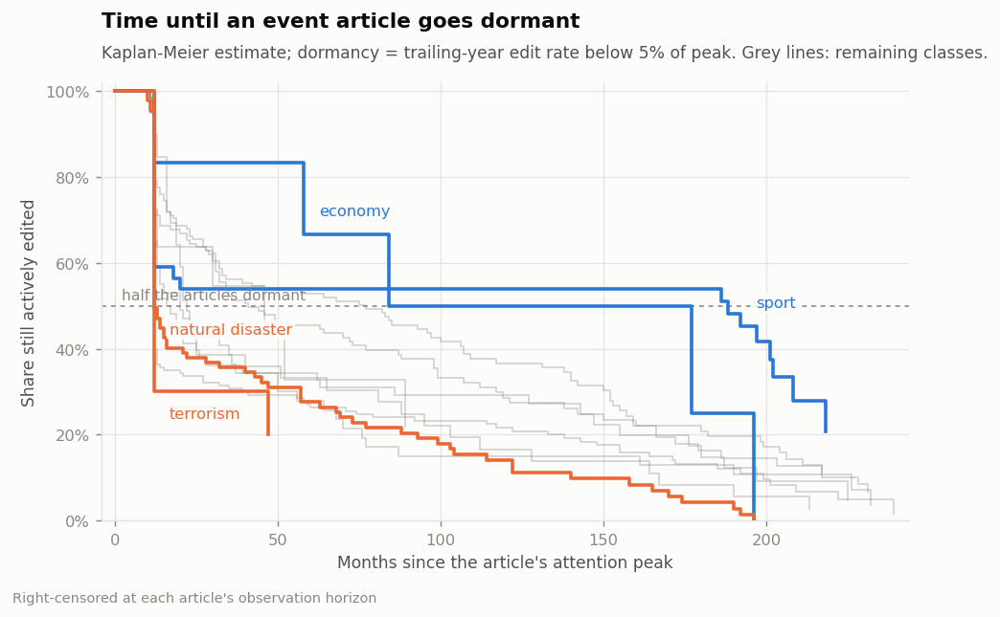
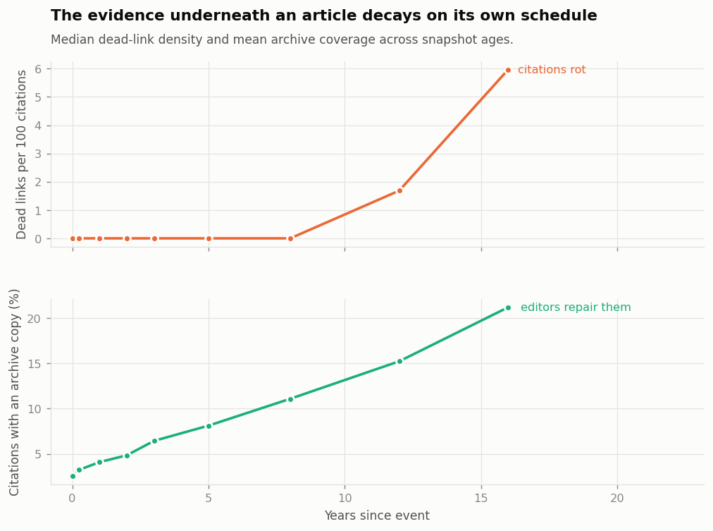
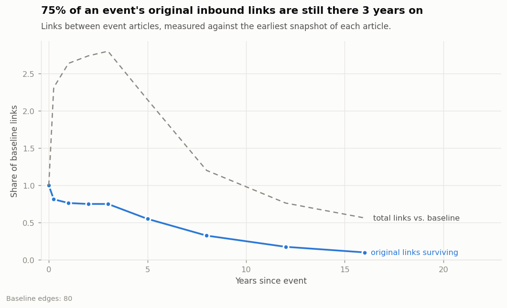

# Institutional Memory Decay

### Measuring the forgetting curve for world events through Wikipedia's edit histories

---

> **Status of the numbers in this report.** Every quantitative result below is
> measured from **live English Wikipedia data**: 690 event articles, 239,197
> revisions, 5,165 wikitext snapshots and 73,726 monthly pageview observations,
> collected over 6,900 API requests in August 2026. Sections marked
> **[MEASURED]** report that run. Section 4 is marked **[VALIDATION]** and is
> the one place synthetic data appears on purpose: estimator recovery can only
> be checked against parameters that are known, which means simulating them.
> That validation run is preserved separately in
> `outputs/validation_synthetic/`. Sections marked **[METHOD]** hold regardless
> of data source.

---

## 1. The question

Every event that matters enough to get a Wikipedia article gets a burst of
attention: hundreds of editors, thousands of revisions, a wall of citations to
breaking news. Then the attention drains away. This report measures the shape
of that draining and asks which kinds of events resist it.

Wikipedia offers something better than a survey of what people remember: a
continuous, timestamped record of how much work a society's volunteer
encyclopedia is willing to do on an event, month after month, for up to twenty
years. That record is not memory, but it is a durable trace of collective
attention, and it can be measured rather than recalled.

## 2. What is being measured [METHOD]

Four layers that decay on different schedules:

| Layer | Observable | Interpretation |
|---|---|---|
| Attention | human edits per month | is anyone still working on it |
| Substance | article bytes, citation count | is the record still growing |
| Structure | inbound links from other event articles | is the event still used to explain other things |
| Evidence | dead-link tags, archive coverage | do the sources still exist |

Bot edits are excluded throughout. They run at a roughly constant rate and
would flatten every curve toward artificial persistence. On the real corpus
they are 5.4% of revisions, and the name-plus-tag heuristic that identifies
them was audited against the actual top-flagged accounts (`Citation bot`,
`AnomieBOT`, `InternetArchiveBot`, `GreenC bot`, ...) with no false positives
among them.

### 2.1 Anchoring time

Every curve here is measured on an axis of *months since the event*, so a wrong
*t*₀ does not add noise — it smears the peak and biases the fitted half-life
upward. Resolution order:

1. **Wikidata P585/P580/P571**, but only at **month precision or finer**. A
   year-precision claim parses to January 1st, which is a placeholder rather
   than a date; on this corpus, accepting those would have put *t*₀ up to
   eleven months early for roughly a third of the Wikidata-dated articles, and
   always in the same direction.
2. **First revision timestamp** otherwise. For a contemporaneous article this
   is accurate to hours.

On the real corpus the fallback carries the majority of the weight: 395 of 690
articles are dated from their first revision, 295 from Wikidata. Articles
created more than three years after their event are dropped as retrospective
rather than contemporaneous records, along with redirects, disambiguation
pages, and chronicle pages (`2015 in music`, `Deaths in 2015`) that sit inside
the year-scoped categories without being events.

Articles that never accumulated 40 human revisions are also dropped: 212 of the
902 dated candidates, with a median of 23 revisions each. A decay curve needs
something to decay from, and fitting a hazard model to a two-paragraph stub
measures Poisson noise.

### 2.2 Fitting

The observable is a monthly count spanning four orders of magnitude within a
single article's history. Least squares on raw counts is dominated by the peak
month; least squares on log counts is undefined for the many months with zero
edits. Both are avoided by fitting **Poisson maximum likelihood**, which also
makes AICc comparison across functional forms legitimate.

Four candidate laws, fitted per article:

| Form | Expression | Interpretation |
|---|---|---|
| Exponential | *A*·e^(−*t*/τ) | constant hazard of being forgotten |
| Power law | *A*·(*t*+1)^−*b* | scale-free decay |
| Stretched exponential | *A*·e^(−(*t*/τ)^β) | standard form in human-dynamics work |
| **Power law with floor** | *A*·(*t*+1)^−*b* + *c* | decay onto permanent maintenance |

## 3. Two measurement failures worth reporting [METHOD]

Both were found by validating estimators against simulated histories rather
than by reading the code, and both materially changed the results.

**Resurgences corrupt the decay estimate.** Anniversary coverage, a verdict, a
later related event — each adds a burst on top of the ongoing decay. Left in, a
single large bump drags the fitted exponent toward zero and makes a fast-fading
event look persistent. Fitting now runs twice, masking months whose Pearson
residual exceeds +3 **on the high side only**: a quiet month is signal, never
an outlier. Exponent recovery went from ρ = 0.27 to 0.76.

**Unconstrained peak-finding chases those same resurgences.** An unrestricted
argmax put the attention peak of some articles 33 months after the event, so
"months since peak" began counting from the resurgence and discarded the entire
original decay. The peak search is now confined to the first year, where an
event's peak is by construction.

## 4. Estimator validation [VALIDATION]

286 simulated articles across 11 event classes, each generated from drawn
values of amplitude, decay exponent, floor height and resurgence count, then
put through the same estimators. This is the only synthetic result in the
report, and it is here because a fitted parameter is worth reporting only if
the fitting code can recover a parameter it was given.


| Parameter | Pearson *r* | Spearman ρ | Median bias |
|---|---|---|---|
| Decay exponent *b* | 0.76 | 0.76 | −0.30 |
| Half-life (empirical) | 0.74 | 0.76 | −0.67 mo |
| Half-life (fitted) | 0.35 | 0.80 | −0.84 mo |
| Maintenance floor share | 0.36 | **0.18** | +0.00 |

The *rank* recovery of exponent and half-life (ρ ≈ 0.76–0.80) is good, which is
what the project needs: every substantive claim here is comparative, and
comparative claims live on ranks. The exponent carries a systematic **−0.30
bias**, close to constant across articles, so absolute exponents should be read
with it attached.

**The floor does not recover per article** (ρ = 0.18), because the floor is a
few percent of peak and monthly counts that small are Poisson noise. On the
real corpus the median fitted floor is 0.4% of peak, which is exactly the
regime the validation says is unreliable. `floor_share_of_peak` is therefore
**excluded** from the composite resistance index, and the floor is used only as
an aggregate model-selection result.

Three tests fail if recovery drops below these levels, on the principle that if
the estimators stop working the report's numbers stop being trustworthy and
someone should be told loudly.

## 5. The shape of forgetting [MEASURED]



Each article is normalised to its own peak before averaging, so one enormous
event cannot define the corpus curve. On log–log axes a power law is a straight
line, which makes the shape of the data the finding rather than the decoration.



Averaged Akaike weights across 688 fitted articles:

| Form | Mean Akaike weight | Best-fit share |
|---|---|---|
| Power law with floor | 46.3% | 45.6% |
| Stretched exponential | 33.7% | 32.8% |
| Power law | 12.2% | 13.1% |
| Exponential | 7.8% | 8.4% |

**The pure exponential is decisively the worst of the four**, taking under 8%
of the weight. Collective forgetting on Wikipedia is not the constant-hazard
process the individual Ebbinghaus curve describes: there is no characteristic
forgetting timescale at which the same relative decay reliably happens.

The honest qualifier is that the runner-up is closer than the synthetic
validation suggested. Stretched exponential takes a third of the weight — far
more than the 15% it took on simulated power-law data — so the real corpus is
better described as *heavy-tailed* than as specifically power-law. Separating
the two would need finer-grained early data than a monthly panel provides.

**A resolution limit worth stating plainly.** The median empirical half-life is
**1.34 months**, and 78% of articles peak in the calendar month of the event
itself. Two-thirds of the corpus has a half-life below 1.5 months, which is the
narrow band the estimator produces when an article is already under half its
peak rate by the very next monthly bin. Real event articles decay faster than a
monthly panel can resolve. The number is a genuine measurement, but it is
pressed against the floor of the instrument, and the between-class comparisons
in the next section are consequently driven by the minority of articles that
decay slowly enough to be resolved. A weekly panel over the first year would
fix this and is the single highest-value change to make next.

## 6. Which events resist decay [MEASURED]



Kruskal–Wallis across the 11 classes on empirical half-life: **H = 85.7,
p = 3.8 × 10⁻¹⁴, ε² = 0.115**, with 21 of 55 pairwise comparisons significant
after Benjamini–Hochberg correction.

The omnibus test is unambiguous but the effect is modest, and the structure
behind it is narrow: **elections are the outlier.** Election articles have a
median half-life of 2.6 months against 1.3 for terrorism and transport
accidents — a 2.0× spread — while eight of the eleven classes sit within 0.15
months of one another, which is below the resolution discussed above. The
defensible claim is *elections and, more weakly, sport and economy hold
attention longer than the rest*, not that the eleven classes form a graded
ranking.

Three classes (economy, n = 6; terrorism, n = 10; epidemic, n = 11) are too
small for their intervals to mean much, a consequence of Wikipedia's
year-scoped categories being far richer for culture and transport than for
economics.



The survival framing is the more careful version of the same question. An
article is **dormant** at the first month its trailing-year edit rate drops
below 5% of peak *and stays there*. Articles still active at the end of the
observation window are right-censored, not dropped and not counted as
long-lived. Log-rank across classes: **χ²(10) = 48.3, p = 5.4 × 10⁻⁷**.

## 7. What predicts persistence [MEASURED]

A gradient-boosted model of log half-life on features measurable in the event's
**first year**: cross-validated R² = **0.29** against a median baseline.
Permutation importance:

| Feature | Importance |
|---|---|
| Distinct editors in year 1 | 1.02 |
| Peak edit rate | 0.94 |
| Event class = election | 0.24 |
| Article size at *t*₀ | 0.09 |
| Anonymous edit share, year 1 | 0.07 |

The synthetic validation run produced a clean story here — breadth of
participation (1.30) beating intensity of coverage (0.41) by three to one — and
**the real data does not support it**. Distinct editors and peak edit rate come
out effectively tied (1.02 vs 0.94), and the two are strongly collinear in any
case: events that draw many edits draw many editors. The honest reading is that
first-year *volume*, however measured, predicts persistence, and this corpus
cannot separate breadth from intensity. The remaining features add little, and
R² = 0.29 means most of what determines an article's half-life is not visible
in its first year at all.

## 8. The evidence decays on its own schedule [MEASURED]



Two panels sharing one x-axis, never a dual y-axis: dead-link density and
archive coverage are different measures on different scales, and overlaying
them on twin axes would let the visual crossover point be set by the choice of
scale rather than by the data.

| Years since event | Dead links per 100 URLs (mean) | (median) | Archive coverage |
|---|---|---|---|
| 0 | 0.02 | 0 | 2.5% |
| 1 | 0.31 | 0 | 4.1% |
| 3 | 1.15 | 0 | 6.4% |
| 5 | 2.11 | 0 | 8.1% |
| 8 | 4.03 | 0 | 11.1% |
| 12 | 7.79 | 1.69 | 15.2% |
| 16 | 11.01 | 5.97 | 21.2% |

This is the cleanest result in the report. Mean dead-link density rises
monotonically across the whole observation window, driven by the ordinary
mortality of URLs and entirely independent of whether anyone is still editing.
Archiving campaigns push coverage up in parallel — a roughly eightfold
improvement over sixteen years — but they are not keeping pace: an article's
evidence base rots faster than the encyclopedia repairs it.

The gap between the mean and median columns is itself the finding, and it is
why the figure plots the median. For the first eight years the *typical* event
article carries no dead-link tags at all: rot is concentrated in a minority of
articles while most look untouched. Only past a decade does it become the
common condition, at which point the median climbs steeply. Link rot is not a
slow uniform drizzle across the corpus — it is a threshold that articles cross
one at a time, and the mean is picking up the early crossers long before the
typical article is affected.



Of the links present at an article's first snapshot, the share still present
later:

| Years since event | Surviving baseline links | Total links vs. baseline |
|---|---|---|
| 1 | 76% | 2.6× |
| 3 | 75% | 2.8× |
| 5 | 55% | 2.2× |
| 8 | 33% | 1.2× |
| 16 | 10% | 0.6× |

**Structure outlives attention, and by a wide margin.** The median article has
zero human edits in month 12, yet three-quarters of its inbound links are still
in place three years out, and total inbound links are still *growing* to 2.8×
baseline at that point. An event stops being worked on long before it stops
being useful for explaining other things. Being cited as context is a cheaper
form of remembering than editing, and it persists after the editing stops.

That said, this is the weakest-powered layer here, and the figure states its
own sample size for that reason: **80 baseline edges across 690 articles**. The
corpus is a sample of Wikipedia, so links *between sampled articles* are rare
by construction — only 125 of 690 articles have any inbound link from another
corpus member at one year. The trajectory is consistent and monotone, but a
denser corpus is needed before the numbers in that table should be quoted
individually.

## 9. Limitations [METHOD]

**The monthly panel is too coarse for the early curve**, as section 5 sets out.
This is the binding limitation on the headline half-life numbers.

**The internal-link layer is sparse by construction**, as section 8 sets out.

**Edits proxy attention; they are not attention.** Pageviews are collected
where available, but the Wikimedia pageviews API only reaches July 2015 and
cannot anchor a curve for a 2008 event. Those months are structurally missing
rather than zero and are handled as such.

**English Wikipedia only.** "Collective memory" here is one language edition's
editor community, which is not the world.

**Editing effort is not remembering.** An article can be complete and correct
and therefore need no edits. The maintenance-floor parameter is the attempt to
separate "finished" from "abandoned", and per section 4 it does not do that
reliably at the article level.

**Category membership proxies event type**, and Wikipedia's categories are
inconsistent, overlapping, and very unevenly deep across subject areas — which
is why three of the eleven classes have fewer than a dozen articles.

**Bot exclusion is heuristic**, resting on the naming convention and the `bot`
change tag.

## 10. What the real run changed

Four things look different from the pre-registered synthetic expectations, and
they are recorded here because the point of fixing the numbers in advance was
to be able to notice:

1. **The exponential is out, but the power law did not win cleanly.** Stretched
   exponential more than doubled its share against the synthetic run. The
   corpus is heavy-tailed; which heavy tail is unresolved.
2. **Class differences are real but narrow**, and are essentially "elections
   versus everything else" rather than a graded ranking. ε² = 0.115, not 0.38.
3. **Breadth of participation does not beat intensity of coverage.** They tie,
   and the corpus cannot separate them. The synthetic run's clean 3:1 ordering
   was an artefact of the generative model.
4. **Attention and structure decouple.** Editing stops within a year for the
   median article while three-quarters of inbound links survive three years,
   and total links keep growing. The simulator had links decaying *faster* than
   attention, which is the opposite of what Wikipedia does.

Reproduce with:

```bash
export IMD_CONTACT="you@example.com"
imd corpus && imd collect && imd analyze && imd figures
```

The collection run behind this report took about 48 minutes wall-clock and made
6,900 API requests with zero errors. Every response is cached, so re-running
the analysis costs no network at all.

---

*Every figure in this report is generated by `imd figures`. Statistical results
are in `outputs/findings.json`; pairwise comparisons and feature importances are
written alongside it as CSV. The synthetic validation run of section 4 is
preserved in `outputs/validation_synthetic/`.*
