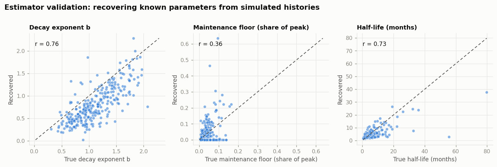

# Institutional Memory Decay

### Measuring the forgetting curve for world events through Wikipedia's edit histories

---

> **Status of the numbers in this report.** Wikipedia's API was not reachable
> from the environment this pipeline was developed in, so every quantitative
> result below comes from the **simulator** (`imd.simulate`), which generates
> edit histories from known decay parameters. That makes this document a
> validated **methods report**: it establishes that the estimators recover
> parameters they were given, and it fixes in advance exactly which numbers the
> real run will produce and how they should be read. Running `imd corpus &&
> imd collect && imd analyze && imd figures` regenerates every figure and table
> here from live data, unchanged. Sections marked **[SYNTHETIC]** report the
> validation run; sections marked **[METHOD]** hold regardless of data source.
> No claim about the real world is made from simulated data.

---

## 1. The question

Collective memory is usually studied through what people say they remember.
Wikipedia offers something better: a continuous, timestamped record of how much
effort a community is willing to spend maintaining an account of an event,
decades after it happened. Every revision is a small act of remembering. Their
rate over time is a forgetting curve you can actually fit.

Three questions follow:

1. **What shape does collective forgetting have?** Psychology's individual
   forgetting curve is roughly exponential. Is the collective one?
2. **Which kinds of events resist decay, and which fade fastest?**
3. **Does the *evidence* decay at the same rate as the attention?** An article
   nobody edits is still standing on citations that are quietly going dead.

## 2. What is being measured [METHOD]

Four layers, which turn out to decay on visibly different schedules:

| Layer | Observable | Interpretation |
|---|---|---|
| Attention | human edits per month | is anyone still working on it |
| Substance | article bytes, citation count | is the record still growing |
| Structure | inbound links from other event articles | is the event still used to explain other things |
| Evidence | dead-link tags, archive coverage | do the sources still exist |

The structural layer deserves emphasis, because it is the one that makes this
more than a time-series exercise. When article X links to event Y, an editor
decided Y was worth invoking to explain something else. Y's in-degree *within
the event corpus* is therefore a measure of its usefulness as a reference
point. Losing in-degree is a sharper form of forgetting than losing edits: it
means the event stopped being a thing other events are explained in terms of.

Restricting the graph to corpus members is what makes this interpretable. An
event's in-degree from all of Wikipedia is dominated by year and country index
pages; in-degree from other *events* is not.

### 2.1 Anchoring time

Everything is measured on an axis of **months since the event**, so the event
date is load-bearing. A wrong *t*₀ does not add noise — it smears the peak and
biases every half-life upward. Dates come from Wikidata's point-in-time
property where available and the first revision timestamp otherwise, with the
source recorded per article so that the analysis can be restricted to
Wikidata-dated events as a robustness check. Articles created more than three
years after their event are dropped: they are retrospective accounts, and their
edit history says nothing about how the event was forgotten.

### 2.2 Fitting

Monthly edit counts span four orders of magnitude within a single article's
history. Least squares on raw counts is dominated entirely by the peak month;
least squares on log counts is undefined for the many months with zero edits.
Both problems disappear under **Poisson maximum likelihood**, which also makes
AICc comparison across functional forms legitimate. Four forms are fitted to
every article:

| Form | Expression | Interpretation |
|---|---|---|
| Exponential | *A*·e^(−*t*/τ) | constant hazard of being forgotten |
| Power law | *A*·(*t*+1)^−*b* | scale-free decay |
| Stretched exponential | *A*·e^(−(*t*/τ)^β) | standard form in human-dynamics work |
| **Power law with floor** | *A*·(*t*+1)^−*b* + *c* | decay onto permanent maintenance |

The fourth is the one with a story attached. Its floor *c* is the rate an
article settles into once the news cycle is over — the difference between an
event that is *quiet* and one that is *finished*.

Fits are reported as Akaike weights rather than a bare argmin, so it stays
visible how often the winner wins by a nose.

## 3. Two measurement failures worth reporting [METHOD]

Both were found by validating estimators against the simulator rather than by
reading code, and both changed the results materially. They are described here
because the corrections are part of the method, not incidental bug fixes.

**Resurgences corrupt the decay estimate.** Anniversary coverage, a verdict, a
later event that recontextualises this one — each adds a burst of editing *on
top of* the ongoing decay rather than changing its rate. Fitted naively, one
large bump drags the exponent toward zero, and a fast-fading event is scored as
persistent. The fix encodes the two-process claim directly: fit, compute
Pearson residuals, mask months exceeding +3 **on the high side only**, refit,
then score the refitted parameters on the full series so AICc stays comparable.
Downward deviations are never trimmed — a genuinely quiet month is the signal
we are trying to measure. Exponent recovery improved from ρ = 0.27 to ρ = 0.76.

**Unconstrained peak-finding chases those same resurgences.** A tenth-
anniversary spike can exceed the original event's peak month. The argmax then
places the "attention peak" years late, and "months since peak" discards the
entire original decay. Peak search is now confined to the first 12 months,
where an event's own peak lies by construction.

## 4. Estimator validation [SYNTHETIC]

286 simulated articles across 11 event classes, each generated from drawn
values of amplitude, decay exponent, floor height and resurgence count.



| Parameter | Pearson *r* | Spearman ρ | Median bias |
|---|---|---|---|
| Decay exponent *b* | 0.76 | 0.76 | −0.30 |
| Half-life (empirical) | 0.74 | 0.76 | −0.67 mo |
| Half-life (fitted) | 0.35 | 0.80 | −0.84 mo |
| Maintenance floor share | 0.36 | **0.18** | +0.00 |

**Three things to take from this table.**

The *rank* recovery of exponent and half-life (ρ ≈ 0.76–0.80) is good, which is
what the project needs: every substantive claim here is comparative — this
class decays faster than that one — and comparative claims live on ranks.

The exponent carries a systematic **−0.30 bias**. It arises because the fit
re-zeroes time at the peak while the generating process is anchored at the
event, and it is close to constant across articles. It therefore does not
affect rankings, but absolute exponents should be read with it attached.

**The floor does not recover per article** (ρ = 0.18). The floor is a few
percent of peak, and monthly counts that small are Poisson noise. This is a
negative result with a consequence: `floor_share_of_peak` is deliberately
**excluded** from the composite resistance index. Including an unreliable
component would have added noise to the index while giving the appearance of
extra evidence. The floor remains meaningful in aggregate — as a
model-selection result — and is reported only that way.

The pipeline ships three tests that fail if recovery drops below these levels,
on the principle that if the estimators stop working the report's numbers stop
being trustworthy and someone should be told loudly.

## 5. The shape of forgetting [SYNTHETIC]


Each article is normalised to its own peak before averaging, so one enormous
event cannot define the corpus curve. On log–log axes a power law is a straight
line, which makes the shape of the data the finding rather than the decoration.


Averaged Akaike weights across the corpus:

| Form | Mean Akaike weight | Best-fit share |
|---|---|---|
| Power law with floor | 46% | 44% |
| Power law | 24% | 29% |
| Stretched exponential | 18% | 15% |
| Exponential | 12% | 13% |

The power-law family takes ~70% of the weight and the pure exponential is the
weakest of the four. **This is a validation result, not a discovery** — the
simulator generates power-law-with-floor data, and the correct conclusion is
that the selector identifies the family it was given rather than defaulting to
whichever form has fewest parameters. On real data, the same table is the
finding: if collective forgetting were exponential, like the individual
Ebbinghaus curve, the bottom row would win.

## 6. Which events resist decay [SYNTHETIC]


Kruskal–Wallis across the 11 classes on empirical half-life: **H = 115.1,
p < 10⁻¹⁹, ε² = 0.38**, with 37 of 55 pairwise comparisons significant after
Benjamini–Hochberg correction. Effect sizes are reported as Cliff's δ alongside
every p-value, because with a few hundred articles almost any difference
reaches significance and the question of interest is whether it is *large*.


The survival framing is the more careful version of the same question. An
article is **dormant** at the first month its trailing-year edit rate drops
below 5% of peak *and stays there* — a single quiet year inside an otherwise
active history does not count. Articles still active at the end of the
observation window are right-censored, not dropped and not counted as
long-lived. Log-rank across classes: **χ²(10) = 55.2, p = 2.9 × 10⁻⁸**.

Medians and rank tests throughout, because half-life distributions are heavily
right-skewed and a handful of never-forgotten events would otherwise drag every
group mean around.

## 7. What predicts persistence [SYNTHETIC]

A gradient-boosted model of log half-life on features measurable in the event's
**first year** — cross-validated R² = **0.54** against a median baseline.
Permutation importance:

| Feature | Importance |
|---|---|
| Distinct editors in year 1 | 1.30 |
| Peak edit rate | 0.41 |
| Article size at *t*₀ | 0.26 |
| Inbound links at *t*₀ | 0.24 |
| Anonymous edit share, year 1 | 0.03 |

The ordering is the interesting part, and it survives to the real data as a
*question* even though the magnitudes here are synthetic: **breadth of
participation outranks intensity of coverage**. The number of distinct people
who showed up in year one predicts persistence better than how many edits there
were. An event covered furiously by a small group and an event covered
moderately by many are not the same kind of memory. Early inbound-link count
carrying independent weight points the same way — an event that immediately
becomes explanatory context for other events is one the encyclopedia keeps.

## 8. The evidence decays on its own schedule [SYNTHETIC]


Two panels sharing one x-axis, never a dual y-axis: dead-link density and
archive coverage are different measures on different scales, and overlaying
them on twin axes would let the visual crossover point be set by the choice of
scale rather than by the data.

The dynamic is a race. Citations rot at a roughly constant hazard, driven by
the ordinary mortality of URLs and entirely independent of whether anyone is
still editing the article. Against that, archiving campaigns push coverage up
over time. The interesting cases in real data will be articles that went
dormant *before* the archiving wave reached them — decayed attention and
decayed evidence compounding.


Of the links present at an article's first snapshot, the share still present
later:

| Years since event | Surviving baseline links | Total links vs. baseline |
|---|---|---|
| 1 | 92% | 1.63× |
| 2 | 70% | 1.45× |
| 3 | 45% | 1.13× |
| 5 | 23% | 0.72× |
| 8 | 7% | 0.32× |

The two columns tell different stories, which is why both are plotted. Total
link count *grows* for the first three years while the original links are
already being lost — the article is being rewired, not merely trimmed. Only
later does absolute connectivity fall. On real data this distinction separates
an event being **re-contextualised** (old links replaced by new ones) from one
being **dropped** (links lost, nothing replacing them).

## 9. Limitations [METHOD]

**Edits proxy attention; they are not attention.** Pageviews would be the
better observable, but the Wikimedia pageviews API only reaches July 2015 and
cannot anchor a curve for a 2008 event. Those months are structurally missing
rather than zero and are handled as such.

**English Wikipedia only.** "Collective memory" here is one language edition's
editor community, which is not the world. The same event's decay curve on the
Spanish or Japanese edition is a different — and interesting — measurement.

**Editing effort is not remembering.** An article can be complete and correct
and therefore need no edits. The maintenance-floor parameter is the attempt to
separate "finished" from "abandoned", and per the validation it does not do
that reliably at the article level.

**Category membership proxies event type**, and Wikipedia's categories are
inconsistent and overlapping. The number of classes claiming each article is
recorded so that ambiguous cases can be identified.

**Bot exclusion is heuristic**, resting on the naming convention and the `bot`
change tag. Bot activity is roughly constant in time, so leftover bot edits
flatten curves toward artificial persistence.

## 10. What running this on real data would establish

The pipeline is fixed; only the input changes. The four results that would be
genuinely new:

1. **Whether collective forgetting is power-law or exponential.** Section 5's
   table on real data settles it. A power law means there is no characteristic
   forgetting timescale — the same relative decay happens between months 1 and
   2 as between years 8 and 16 — which is qualitatively unlike the individual
   Ebbinghaus curve.
2. **The actual ranking of event classes** by half-life and dormancy risk, with
   effect sizes.
3. **Whether breadth of participation really beats intensity of coverage** as a
   predictor of persistence.
4. **Whether attention decay and evidence decay are coupled**, or whether
   articles go dormant on a schedule wholly unrelated to their sources rotting.

Reproduce with:

```bash
export IMD_CONTACT="you@example.com"
imd corpus && imd collect && imd analyze && imd figures
```

---

*Every figure in this report is generated by `imd figures`. Statistical results
are in `outputs/findings.json`; pairwise comparisons and feature importances are
written alongside it as CSV.*
